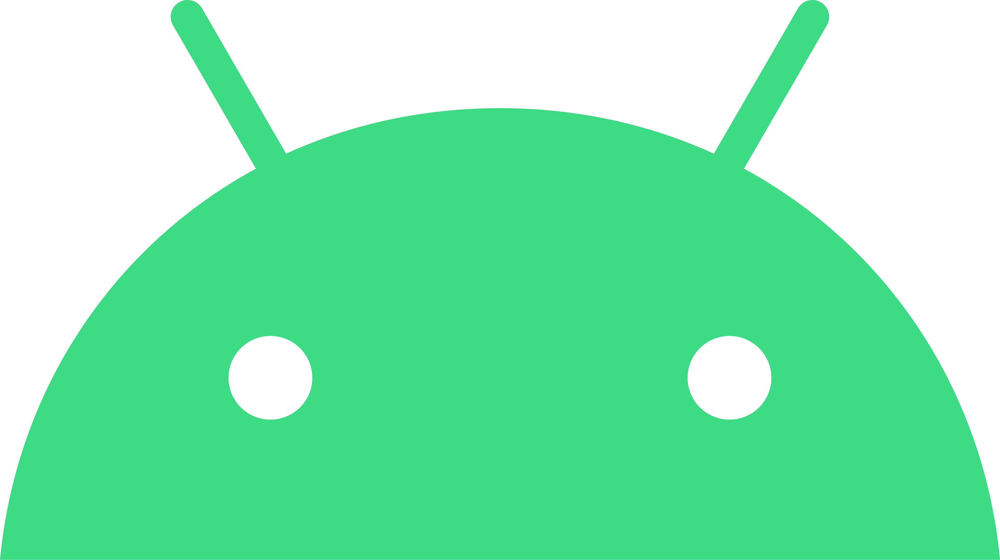

<p align="center">
  
</p>

<h1 align="center">Android Display</h1>

<p align="center">
  Native Windows 11 Win32 C++ application for low-latency Android screen, desktop, and camera mirroring over USB and Wireless ADB.
</p>

---

## Features

- **Single Portable Executable**: Bundles `adb.exe`, `AdbWinApi.dll`, `AdbWinUsbApi.dll`, and `android-display-server.jar` directly inside `AndroidDisplay.exe` as embedded resources—no external ADB installation required.
- **Native Windows 11 UI**:
  - Automatic Dark / Light mode via `DWMWA_USE_IMMERSIVE_DARK_MODE` and rounded window corners (`DWMWCP_ROUND`).
  - Per-Monitor V2 DPI awareness with ClearType `Segoe UI` typography and Direct2D / DXGI Flip-Discard hardware-accelerated rendering.
  - **Immersive Mode** (titlebar toggle button) and **Fullscreen Mode** (`F11` / `Alt+F`).
- **Multiple Video Sources**:
  - **Display**: Mirror the device's main screen.
  - **New Display (Desktop)**: Spawn an independent virtual desktop display with custom resolution and DPI.
  - **Simulate Secondary Displays**: Create and mirror Android's `overlay_display_devices` secondary display with custom resolution and DPI (automatically disabled on stop or exit).
  - **Back Camera / Front Camera**: Stream the device camera with live zoom slider and tap-to-focus.
- **Low-Latency Streaming Controls**:
  - **Resolutions**: `Native`, `1080p`, `720p` (plus custom `WxH` and DPI for desktop / simulated secondary display modes).
  - **Bitrates**: `2 Mbps`, `4 Mbps`, `8 Mbps`, `12 Mbps`, `16 Mbps`, `24 Mbps`.
  - **Frame Rates**: `Auto`, `120 fps`, `90 fps`, `60 fps`, `45 fps`, `30 fps`, `24 fps`.
  - **Orientation Lock**: `Auto`, `Portrait`, `Landscape`.
- **Audio & Device Options**:
  - **Mirror Audio**: System Output (`REMOTE_SUBMIX`) or Microphone (`MIC`).
  - **Always on Top**, **Turn Screen Off**, **Stay Awake**, and **Show Touches**.
- **Interactive Input & Utilities**:
  - `scrcpy`-style mouse hover (`ACTION_HOVER_MOVE`), click/drag (`SOURCE_MOUSE`), and scroll wheel support.
  - Keyboard input, navigation keys, and two-way clipboard sync (`Ctrl+C`, `Ctrl+X`, `Ctrl+V`).
  - **Wireless ADB** connection & pairing (`IP:Port`, 6-digit pairing code, and **QR code** mDNS pairing).
  - **MP4 Recording**, **PNG Screenshots**, and **Drag & Drop** APK installation or file push to `/sdcard/Download/`.

---

## Shortcuts

| Shortcut / Input | Action |
|---|---|
| `F11` or `Alt + F` | Toggle Fullscreen |
| `Right Click` | Android Back |
| `Middle Click` | Android Home |
| `Ctrl + C` / `Alt + C` | Copy |
| `Ctrl + X` / `Alt + X` | Cut |
| `Ctrl + V` / `Alt + V` | Paste from PC clipboard |
| `Alt + O` | Toggle device physical screen power |
| `Alt + R` | Rotate device |
| `Alt + N` / `Alt + Shift + N` | Expand / collapse notifications |

---

## Requirements

- **OS**: Windows 10 / Windows 11 (x64)
- **Device**: Android device with **USB Debugging** (or **Wireless Debugging** on Android 11+) enabled in Developer Options

---

## Building from Source

### Prerequisites
- Visual Studio 2026 (Desktop development with C++ / Windows SDK)
- Android SDK + JDK (only needed if modifying `server/src/com/androiddisplay/Server.java`)

### Build Application
```bat
build.bat
```
Outputs `AndroidDisplay.exe` in the repository root.

### Rebuild Device Server (Optional)
If you edit `server/src/com/androiddisplay/Server.java`, compile with `javac` (against `android.jar`) and package `classes.dex` into `server/android-display-server.jar` using `d8` before running `build.bat`.
